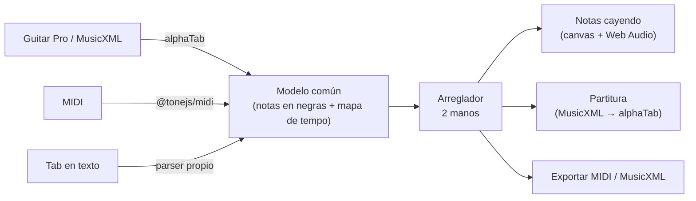

# Riffkeys

**De la tab al piano.** Riffkeys convierte canciones de guitarra (Guitar Pro, MusicXML, MIDI o tablaturas en texto) en un arreglo para piano a dos manos. Lo muestra como notas cayendo y como partitura, y lo exporta a MIDI y MusicXML para seguir trabajándolo en MuseScore.

Nació de una necesidad concreta: tocar metal en piano implica pasar a mano tabs de guitarra a partitura. Riffkeys automatiza ese paso.

## Qué hace

- **Importa** Guitar Pro (`.gp`, `.gp3`, `.gp4`, `.gp5`, `.gpx`), MusicXML (`.xml`, `.musicxml`, `.mxl`), MIDI (`.mid`) y tablaturas en texto pegadas o en `.txt`.
- **Sugiere un reparto**: voz y melodías a la mano derecha, bajo a la izquierda, batería fuera. Con una sola pista de guitarra, «Dividir» manda los graves a la izquierda y el resto a la derecha.
- **Adapta al piano**: mueve cada pista de octava para que caiga en el registro de su mano, une notas dobladas y reduce acordes a lo que una mano alcanza (número de notas y abertura configurables).
- **Notas cayendo** en canvas a 60 fps, sincronizadas con un reproductor propio en Web Audio. Tiene control de velocidad y se puede silenciar una mano para practicarla.
- **Partitura** para piano (pentagramas de Sol y Fa) con la tonalidad estimada automáticamente.
- **Teclado MIDI**: si conectas tu piano por USB, tus teclas se iluminan junto a las del arreglo (Web MIDI, en Chrome y Edge).
- **Exporta** a MIDI (dos pistas: mano derecha e izquierda) y MusicXML.

Todo corre en el navegador: los archivos nunca salen del dispositivo.

## Cómo funciona



- **Un solo modelo interno** (`src/core/model.ts`): cada importador produce notas medidas en negras más un mapa de tempo. Así el arreglador y las vistas no dependen del formato de origen.
- **Guitar Pro y MusicXML** se leen con [alphaTab](https://alphatab.net). Se usa su generador MIDI en vez del modelo de partitura, porque ya resuelve repeticiones, finales alternativos, ligaduras y afinaciones.
- **Tablaturas en texto**: parser propio. Detecta el número de cuerdas (guitarra de 6, 7 u 8 y bajo de 4 o 5), afinaciones bajadas a partir de las etiquetas (Drop D, etc.), trastes de dos cifras y barras de compás. Como las tabs de texto casi nunca traen ritmo, el tiempo se deduce del espaciado y es configurable.
- **Tonalidad**: algoritmo de Krumhansl-Schmuckler, usado para escribir la armadura y elegir entre sostenidos y bemoles.
- **Exportación MusicXML**: cuantiza a semicorcheas, parte figuras en los límites de pulso y de compás con ligaduras, y escribe una voz por pentagrama para que la partitura se pueda leer y aprender.
- **Reproductor**: programa las notas con ~120 ms de anticipación sobre el reloj de Web Audio, para que el audio no dependa de que el hilo principal esté libre.
- **Rendimiento**: alphaTab (~1 MB) solo se descarga al abrir un Guitar Pro o MusicXML, o al ver la partitura.

## Desarrollo

```bash
npm install
npm run dev      # servidor local
npm test         # pruebas (importadores, arreglador, exportadores, tempo, tonalidad)
npm run lint
npm run build
```

Las pruebas usan archivos reales de Guitar Pro y MusicXML (`test-data/`) y verifican ida y vuelta: lo exportado a MIDI y MusicXML se vuelve a importar y conserva las notas.

## Próximos módulos

- **Práctica**: con el teclado MIDI, marcar aciertos y errores en tiempo real, repetir un pasaje en bucle y subir el tempo poco a poco cuando sale limpio.
- **Video de covers**: sobre el video de las manos tocando, marcar las cuatro esquinas del teclado y hacer caer las notas en perspectiva sobre cada tecla (la técnica de [Oblicua](https://oblicua.netlify.app)).

## Créditos

- Lectura de Guitar Pro y MusicXML y dibujo de partituras: [alphaTab](https://github.com/CoderLine/alphaTab) (MPL-2.0).
- Lectura y escritura de MIDI: [@tonejs/midi](https://github.com/Tonejs/Midi) (MIT).
- Código: MIT © Giovanni Raffa.
