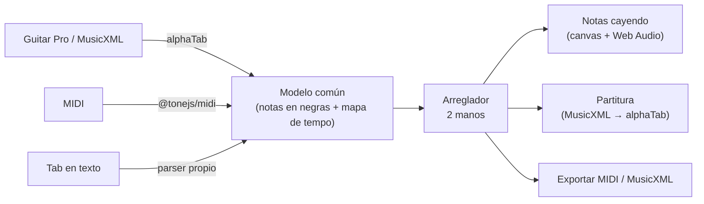

# Riffkeys

**De la tab al piano.** Riffkeys convierte canciones de guitarra (Guitar Pro, MusicXML, MIDI o tablaturas en texto) en un arreglo para piano a dos manos. Lo muestra como notas cayendo y como partitura, y lo exporta a MIDI y MusicXML para seguir trabajándolo en MuseScore.

Nació de una necesidad concreta: tocar metal en piano implica pasar a mano tabs de guitarra a partitura. Riffkeys automatiza ese paso.

## Qué hace

- **Importa** Guitar Pro (`.gp`, `.gp3`, `.gp4`, `.gp5`, `.gpx`), MusicXML (`.xml`, `.musicxml`, `.mxl`), MIDI (`.mid`) y tablaturas en texto pegadas o en `.txt`.
- **Sugiere un reparto**: voz y melodías a la mano derecha, bajo a la izquierda, batería fuera. Con una sola pista de guitarra, «Dividir» manda los graves a la izquierda y el resto a la derecha.
- **Adapta al piano**: mueve cada pista de octava para que caiga en el registro de su mano, une notas dobladas y reduce acordes a lo que una mano alcanza (número de notas y abertura configurables).
- **Opciones para metal**: octavas en la mano izquierda (más peso, como en los covers) y «simplificar ritmos rápidos», que pasa los chugs en semicorcheas a corcheas.
- **Suena a piano de verdad**: piano de cola sampleado (Salamander Grand Piano) con tres capas de intensidad, reverberación de sala y paneo suave por registro. Mientras se descargan las muestras suena un sintetizador.
- **Notas cayendo** en canvas a 60 fps: líneas de compás numeradas, teclas que se hunden, chispas al sonar, zoom y pantalla completa.
- **Práctica**:
  - Elige qué mano tocas tú: deja de sonar y la tocas en tu piano.
  - Con teclado MIDI: aciertos, fallos, notas de más, racha y precisión en tiempo real.
  - Modo **«esperarme»**: la canción se detiene en cada acorde hasta que tocas las teclas correctas.
  - **Bucle** de compases con **subida automática de tempo** en cada vuelta, **metrónomo** y **cuenta previa**.
  - Botón para saltar silencios largos (intros de batería).
- **Partitura** para piano (pentagramas de Sol y Fa) con la tonalidad estimada automáticamente; se puede imprimir o guardar en PDF.
- **Teclado MIDI** (Web MIDI, en Chrome y Edge): tus teclas se iluminan, el pedal de sustain funciona y, si tu teclado no tiene parlantes, puede sonar en la app.
- **Exporta** a MIDI (dos pistas: mano derecha e izquierda) y MusicXML.
- **Recuerda** tus ajustes y la última canción abierta.
- **Atajos**: espacio, ← → (compás), [ ] (velocidad), L (bucle), M (metrónomo), N (nombres), F (pantalla completa).

Todo corre en el navegador: los archivos nunca salen del dispositivo.

## Cómo funciona



- **Un solo modelo interno** (`src/core/model.ts`): cada importador produce notas medidas en negras más un mapa de tempo. Así el arreglador y las vistas no dependen del formato de origen.
- **Guitar Pro y MusicXML** se leen con [alphaTab](https://alphatab.net). Se usa su generador MIDI en vez del modelo de partitura, porque ya resuelve repeticiones, finales alternativos, ligaduras y afinaciones.
- **Tablaturas en texto**: parser propio. Detecta el número de cuerdas (guitarra de 6, 7 u 8 y bajo de 4 o 5), afinaciones bajadas a partir de las etiquetas (Drop D, etc.), trastes de dos cifras y barras de compás. Como las tabs de texto casi nunca traen ritmo, el tiempo se deduce del espaciado y es configurable.
- **Tonalidad**: algoritmo de Krumhansl-Schmuckler, usado para escribir la armadura y elegir entre sostenidos y bemoles.
- **Exportación MusicXML**: cuantiza a semicorcheas, parte figuras en los límites de pulso y de compás con ligaduras, y escribe una voz por pentagrama para que la partitura se pueda leer y aprender.
- **Reproductor**: programa las notas con ~120 ms de anticipación sobre el reloj de Web Audio, para que el audio no dependa de que el hilo principal esté libre. El piano usa una muestra cada tres semitonos, afinada con `playbackRate`; primero se descarga la capa media (≈2 MB) y las otras dos en segundo plano.
- **Modo esperar**: el reproductor nunca programa notas más allá del próximo acorde que debe tocar el usuario; al llegar ahí congela el reloj y lo suelta cuando están todas las teclas.
- **Evaluación** (`src/core/practice.ts`): cada tecla se empareja con la nota esperada más cercana dentro de una ventana de ±180 ms reales; lo que pasa sin tocarse es un fallo.
- **Rendimiento**: alphaTab (~1 MB) solo se descarga al abrir un Guitar Pro o MusicXML, o al ver la partitura.

## Desarrollo

```bash
npm install
npm run dev      # servidor local
npm test         # pruebas (importadores, arreglador, exportadores, tempo, tonalidad)
npm run lint
npm run build
```

Las pruebas usan archivos reales de Guitar Pro y MusicXML (`test-data/`) y verifican ida y vuelta: lo exportado a MIDI y MusicXML se vuelve a importar y conserva las notas.

## Próximos módulos

- **Video de covers**: sobre el video de las manos tocando, marcar las cuatro esquinas del teclado y hacer caer las notas en perspectiva sobre cada tecla (la técnica de [Oblicua](https://oblicua.netlify.app)).

## Créditos

- Lectura de Guitar Pro y MusicXML y dibujo de partituras: [alphaTab](https://github.com/CoderLine/alphaTab) (MPL-2.0).
- Lectura y escritura de MIDI: [@tonejs/midi](https://github.com/Tonejs/Midi) (MIT).
- Muestras de piano: [Salamander Grand Piano V3](https://archive.org/details/SalamanderGrandPianoV3) de Alexander Holm (CC BY 3.0), vía [@audio-samples/piano-mp3](https://github.com/darosh/samples-piano-mp3).
- Código: MIT © Giovanni Raffa.
